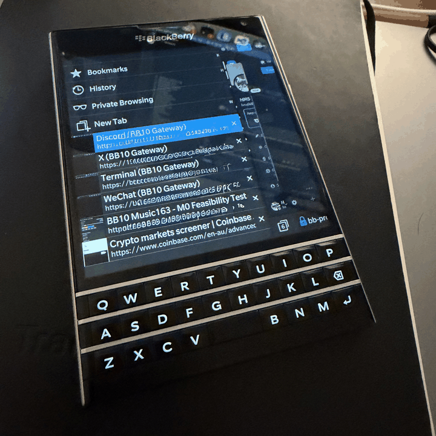

# bb10-gateway-core

[简体中文](README_cn.md)

> Keep your BlackBerry Passport useful: run apps on your NAS, use the BBP's built-in browser as the screen and keyboard. **Zero install on the device.**



## Why

BB10 is end-of-life and its app ecosystem is gone, but the Passport's square screen (1440×1440) and physical QWERTY keyboard are still uniquely productive. This project moves application execution to your home server or NAS, treating the BBP as a lightweight thin client.

- **Zero install on the device.** Powered entirely by the stock browser (HTML5 Canvas + WebSocket, strict ES5). No sideloading, no runtime patching, no device certificates.
- **Upgrade on the NAS only.** Application updates, Chromium bumps, and runtime fixes stay on the server. The BBP never needs reinstalling.
- **One core, many apps.** Add any web app, terminal, or desktop tool with a single declarative configuration file.

## How it works

```text
 BlackBerry Passport (Stock Browser)
      │  ↑ Dirty-rect JPEG stream (binary WebSocket)
      │  ↓ Physical keys / touch / clipboard sync (JSON)
      ▼
 [Optional] VPS L4 Relay ──Tailscale / WireGuard──┐
      │                                           │
      ▼                                           ▼
 gateway.py (aiohttp + TLS 1.2+ + Token Auth) ◄── NAS / Server
      │
 Xvfb :99 ─ Chromium / xterm / Native Linux GUI
```

## Features

| Module | What you get |
|---|---|
| **Display Base** | 720×720 double-buffered canvas, dirty-rect JPEG streaming, auto-pause on screen lock (0 B/s asleep) |
| **Dual-Track Input** | Built for the BB10 keyboard: top-anchored input drawer (avoids IME occlusion), Type/Nav modes, number bar, optional Ctrl/Alt bar |
| **Zero-Trust Auth** | Constant-time token verification, 90-day HttpOnly cookie, LAN TLS 1.2+ with your own Root CA |
| **Sandbox & Watchdog** | Stale lock cleanup (`/tmp/.X99-lock`, Chromium singleton locks), `--disable-gpu`, idle Chromium `SIGSTOP`/`SIGCONT` auto-sleep (`IDLE_SLEEP_SECONDS`, default 30s), process auto-heal |
| **Media & Clipboard** | Photo/file upload from BBP to server clipboard; one-tap sync of server X11 clipboard back to the phone |
| **VPS Relay** *(optional)* | Hardened L4 relay with TLS first-packet shield (`0x16 0x03`) and per-IP rate limiting; your NAS stays unexposed |

## Quick start

Run a working gateway in under 5 minutes:

```bash
# 1. Clone repository
git clone https://github.com/ItsLaurelNotYanny/bb10-gateway-core.git
cd bb10-gateway-core

# 2. Build the core image
docker build -t bb10-gateway-core:latest .

# 3. Create your app environment file
cp deploy/apps/app.env.example x.env
# Set COMPOSE_PROJECT_NAME=bb10-x, PRESET=x, PORT=2444, CERTS_DIR=/path/to/certs

# 4. Start the gateway
docker compose --env-file x.env -f deploy/compose.yml up -d

# 5. Open on BlackBerry Passport browser
# https://<nas-ip>:2444/?t=<TOKEN>
```

> **Note**: For HTTPS trust without browser warnings, install your internal Root CA certificate into the Passport under **Settings -> Security and Privacy -> Certificates**. See [TLS / Root CA](docs/tls.md).

## Presets: one app = one config

Every application is defined by a declarative TOML configuration:

```toml
# presets/x.toml (shipped showcase)
name = "x"
title = "X (Twitter)"
runtime = "chromium"
target_url = "https://x.com/home"
port = 2444
win_w = 720
win_h = 720
layout = "direct"
send_keys = ["ctrl+Return"]
paste_keys = ["ctrl+v"]
jpeg_quality = 85
```

To onboard a new web app, create a `.toml` file in `presets.d/`:

```toml
# presets.d/myapp.toml
name = "myapp"
title = "My App on Passport"
target_url = "https://myapp.example.com"
port = 2447
base = "example"  # Inherits defaults from presets/example.toml
```

## Example apps

- **X (Twitter)**: Full web client running on Chromium, 1:1 square viewport, direct QWERTY shortcut navigation.
- **Discord**: Real-time chat with top-anchored drawer for instant message dispatch without IME occlusion.
- **WhatsApp**: Web client running on Chromium with QR-linked device session and top-anchored instant messaging drawer.
- **Terminal (xterm + tmux)**: Direct host tmux attach with physical Ctrl/Alt modifier bar for remote agent control.

## Compatibility & status

- **Tested hardware**: BlackBerry Passport (SQW100-1), 1440×1440 physical display (`DPR=2`).
- **Tested software**: BlackBerry 10 OS `10.3.3.3216`, stock browser (`AppleWebKit/537.35+`, strict ES5).
- **Status**: Stable for daily personal use; modular architecture.
- **Non-goals**: Video/audio streaming, low-latency 3D gaming, multi-tenant public SaaS, native BAR rewrites.

## Docs

[Module internals](docs/modules.md) · [Relay setup](docs/relay.md) · [TLS / Root CA](docs/tls.md) · [Changelog](CHANGELOG.md)

## License

This project is licensed under the [MIT License](LICENSE).  
Copyright (c) 2026 ItsLaurelNotYanny.
