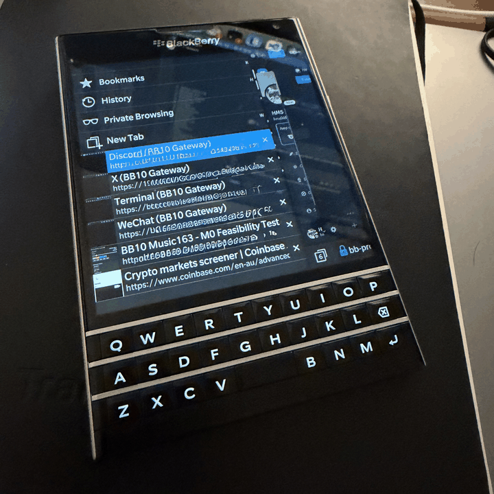

# bb10-gateway-core

[English](README.md)

> 让 BlackBerry Passport 继续有用：业务跑在你的 NAS 上，BBP 只负责显示和输入。**设备端零安装。**



## 为什么需要它

BB10 系统与应用生态已经停摆，但 Passport 的 1:1 方屏 (1440×1440) 与全键盘依然极具生产力。本项目将全部业务逻辑迁移至家庭服务器或 NAS 上，将 BBP 作为纯粹的轻量化终端。

- **设备端零安装**：完全基于系统自带浏览器运行（HTML5 Canvas + WebSocket，严格 ES5 规范）。无需侧载应用、无需修改运行环境、无需自签证书。
- **业务升级仅在 NAS 端**：应用版本、Chromium 升级与运行时维护均在服务端完成，BBP 无需重复安装。
- **一套核心，多款应用**：新增任何 Web 应用、终端工具或桌面程序仅需一份声明式 TOML 配置文件。

## 工作原理

```text
 BlackBerry Passport (Stock Browser)
      │  ↑ Dirty-rect JPEG stream (binary WebSocket)
      │  ↓ Physical keys / touch / clipboard sync (JSON)
      ▼
 [Optional] VPS L4 Relay ──Tailscale / WireGuard──┐
      │                                           │
      ▼                                           ▼
 gateway.py (aiohttp + TLS 1.2+ + Token Auth) ◄── NAS / Server
      │
 Xvfb :99 ─ Chromium / xterm / Native Linux GUI
```

## 核心特性

| 模块 | 核心能力 |
|---|---|
| **显示基座** | 720×720 双缓冲 Canvas 绘制，脏矩形 JPEG 图像流传输，锁屏自动暂停（休眠状态 0 B/s） |
| **双轨输入** | 专为 BB10 键盘打造：顶部锚定输入抽屉（防软键盘遮挡），Type/Nav 模式，数字条，可选 Ctrl/Alt 栏 |
| **零信任认证** | 防时序攻击恒定时间令牌校验，90 天 HttpOnly 安全 Cookie，内网 TLS 1.2+ 与私有自建 Root CA |
| **沙箱与看门狗** | 启动前清理残留锁（`/tmp/.X99-lock`，Chromium 单例锁），无显卡 `--disable-gpu` 防护，空闲 Chromium `SIGSTOP`/`SIGCONT` 自动挂起（`IDLE_SLEEP_SECONDS`，默认 30s），进程异常自愈 |
| **媒体与剪贴板** | 支持从 BBP 上传图片/文件至服务端剪贴板；一键将服务端 X11 剪贴板内容拉取回手机端 |
| **VPS 中继** *(可选)* | 加固型 L4 中继，配备 TLS 首包防护盾（`0x16 0x03` 过滤）与 IP 频率限制，保护 NAS 私网安全 |

## 快速上手

5 分钟内快速拉起一套可用网关：

```bash
# 1. Clone repository
git clone https://github.com/ItsLaurelNotYanny/bb10-gateway-core.git
cd bb10-gateway-core

# 2. Build the core image
docker build -t bb10-gateway-core:latest .

# 3. Create your app environment file
cp deploy/apps/app.env.example x.env
# Set COMPOSE_PROJECT_NAME=bb10-x, PRESET=x, PORT=2444, CERTS_DIR=/path/to/certs

# 4. Start the gateway
docker compose --env-file x.env -f deploy/compose.yml up -d

# 5. Open on BlackBerry Passport browser
# https://<nas-ip>:2444/?t=<TOKEN>
```

> **注意**：为使 Passport 自带浏览器无证书告警信任 HTTPS 连接，请在手机**设置 -> 安全和隐私 -> 证书**中导入自建根证书。详见 [TLS 与根证书指南](docs/tls_cn.md)。

## 预设系统：一个应用 = 一份配置

每个应用均由一份声明式 TOML 配置文件定义：

```toml
# presets/x.toml (shipped showcase)
name = "x"
title = "X (Twitter)"
runtime = "chromium"
target_url = "https://x.com/home"
port = 2444
win_w = 720
win_h = 720
layout = "direct"
send_keys = ["ctrl+Return"]
paste_keys = ["ctrl+v"]
jpeg_quality = 85
```

接入新的 Web 应用只需在 `presets.d/` 目录下放置对应的 `.toml` 文件：

```toml
# presets.d/myapp.toml
name = "myapp"
title = "My App on Passport"
target_url = "https://myapp.example.com"
port = 2447
base = "example"  # Inherits defaults from presets/example.toml
```

## 示例应用

- **X (Twitter)**：Chromium 完整网页端，1:1 方屏视口适配，全键盘快捷键直接导航。
- **Discord**：实时沟通聊天，顶部输入抽屉保障发送时视线不被软键盘候选词遮挡。
- **WhatsApp**：基于 Chromium 运行网页端，通过扫码绑定设备登录，搭配顶部输入抽屉实现即时通讯。
- **Terminal (xterm + tmux)**：直接挂载宿主机 tmux 套接字，配备实体 Ctrl/Alt 修饰键栏，随时随地控制远程终端与 Agent。

## 兼容性与项目状态

- **测试硬件**：BlackBerry Passport (SQW100-1)，1440×1440 物理屏幕（`DPR=2`）。
- **测试系统**：BlackBerry 10 OS `10.3.3.3216`，自带浏览器（`AppleWebKit/537.35+`，严格 ES5 规范）。
- **项目状态**：自用稳定；模块化架构演进。
- **Non-goals (非本项目目标)**：音视频流媒体传输、低延迟 3D 游戏、多租户公共 SaaS 平台、原生 BAR 重写。

## 详细文档

[核心模块内部实现](docs/modules_cn.md) · [VPS 中继配置](docs/relay_cn.md) · [TLS 与根证书指南](docs/tls_cn.md) · [版本变更记录](CHANGELOG_cn.md)

## 开源协议

本项目采用 [MIT 许可证](LICENSE) 进行开源。  
Copyright (c) 2026 ItsLaurelNotYanny.
